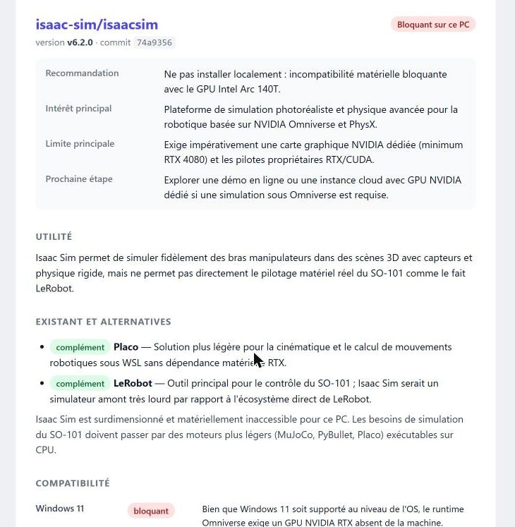
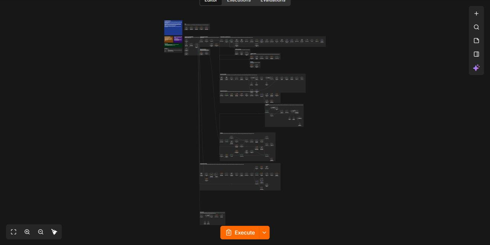
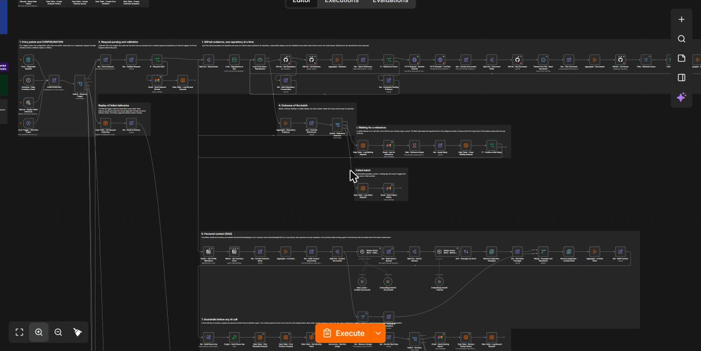
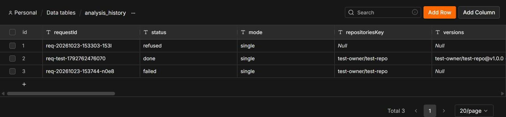
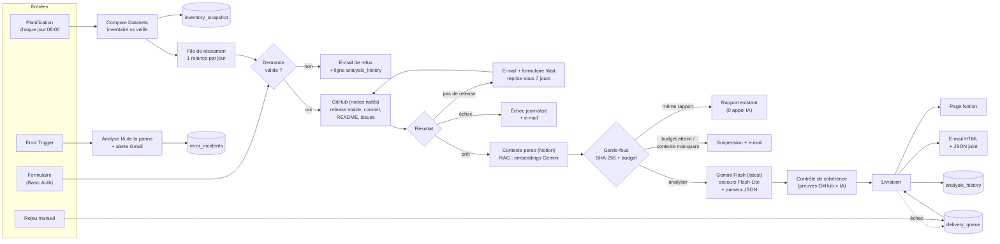

# Ça tourne sur mon PC ? — un seul workflow n8n

> Colle l'URL d'un dépôt GitHub public : le workflow lit la dernière release stable, croise avec **ton** PC et **tes** outils (Notion), demande un diagnostic strict à Gemini, puis t'envoie un rapport en français par e-mail et dans Notion. **Rien n'est installé, rien n'est exécuté** : c'est une analyse de documents.

   

| | |
|---|---|
| Workflow | `Can My PC Run It` (1 workflow, 157 nodes, 20 sticky notes) |
| Formats livrés | [`n8n/workflows/can-my-pc-run-it.workflow.ts`](n8n/workflows/can-my-pc-run-it.workflow.ts) (SDK n8n, pour n8n-cli) et [`exports/can-my-pc-run-it.json`](exports/can-my-pc-run-it.json) (import direct) |
| Schéma du diagnostic | version 2.0 (JSON versionné, joint à chaque e-mail) |
| Données | 4 Data Tables n8n, remplies par le workflow lui-même |
| Version | 3.0 — 23 octobre 2026 (les 7 workflows de la v2 sont fusionnés en un) |

## Aperçu

| E-mail reçu | Une carte par dépôt |
|---|---|
|  |  |

Le workflow dans n8n, vu d'ensemble puis de près (entrées, validation, preuves GitHub) :





Les Data Tables remplies par le workflow (ici l'historique des analyses) :



## Schéma



## Les 4 piliers

1. **Entrées** — formulaire protégé par Basic Auth (mode, URL GitHub, objectif facultatif, références choisies, fiche fictive de test) ; contrôle quotidien de l'inventaire à 8 h ; rejeu manuel des livraisons ratées ; Error Trigger.
2. **Sorties** — page Notion (rapport + JSON), e-mail HTML avec le JSON en pièce jointe ; e-mails d'attente, de refus, de suspension, de rapport existant, d'alerte.
3. **Outils** — GitHub (nodes natifs), Notion (node natif), Gemini (diagnostic, embeddings, analyse d'incident), Gmail, Data Tables, Simple Vector Store (en mémoire).
4. **Architecture** — **un seul workflow**, découpé en 12 blocs visibles (un sticky note gris par bloc) autour d'une seule configuration : le nœud `CONFIGURATION`.

## Les règles du prof, une par une

| Règle | Comment c'est respecté |
|---|---|
| Sticky notes | 20 : fiche de specs (bleu), à faire (jaune), aide humaine (violet), idées (vert), journal des revues (gris) et un sticky gris par bloc — code couleur du cours, imposé par [`n8n-standards.json`](n8n/config/n8n-standards.json) |
| Credentials renommés | `Google Gemini - Free Tier`, `Gmail - Mathieu`, `Notion - Eugenia Workspace`, `Basic Auth - Diagnostic Form`, `GitHub - Public Repositories Read` |
| Workflow propre | noms « Outil - Action » en Title Case anglais, variables en camelCase, une seule configuration, 12 blocs, notes sur chaque Code node |
| Nodes natifs d'abord | GitHub, Notion, Gmail, Data Table, Loop Over Items, Switch, Compare Datasets, XML, Crypto, Summarize, Convert to File, Wait, Simple Vector Store, chaîne LLM Gemini. Seuls **2 Code nodes** (rendu du rapport, contrôle du diagnostic) et **2 HTTP Request** (résolution du commit et liste des fichiers, que le node GitHub ne propose pas) |
| Modèles IA « latest » | `gemini-flash-latest`, `gemini-flash-lite-latest` (secours et analyse d'incident), `gemini-embedding-001` — tous modifiables dans `CONFIGURATION` |
| Moins de workflows | 1 au lieu de 7 |
| n8n-cli | `n8ncli validate` et `n8ncli lint --fail-on-warnings` passent sans avertissement (voir plus bas) |
| Data Tables remplies | 4 tables créées par le workflow (`Manual - Setup Data Tables`) et alimentées à chaque exécution (tableau plus bas) |
| Prompt bien fait | rôle dans le message système, sections XML, 4 exemples, entrées en XML, schéma JSON strict, réponse validée par code : [docs/PROMPTS.md](docs/PROMPTS.md) |

## Les Data Tables

| Table | Rôle | Écrite par |
|---|---|---|
| `analysis_history` | une ligne par demande : statut, versions, clé de réutilisation SHA-256, coût, appels IA, livraison, contexte utilisé, file de réexamen | demande refusée ou échouée, analyse livrée (upsert), rapport réutilisé, suspension, réexamen |
| `delivery_queue` | *dead letter queue* : un diagnostic dont la livraison Notion ou Gmail a échoué, rejouable sans nouvel appel IA | `Data Table - Queue Notion Failure`, `Data Table - Queue Email Failure` ; vidée par le rejeu |
| `error_incidents` | journal des pannes avec l'analyse de Gemini | `Data Table - Log Incident` |
| `inventory_snapshot` | inventaire Notion de la veille, comparé chaque matin | `Data Table - Save Snapshot Item` |

Le budget du mois (5 € par défaut, 12 analyses IA au plus) est calculé **depuis `analysis_history`** avant chaque appel IA.

## Mise en service

### 1. Prérequis

- n8n 2.x (Data Tables, nodes Gemini, Wait avec formulaire).
- Un espace Notion avec le profil machine, la base « Inventaire » et la base « Analyses » : [docs/notion-setup-prompt.md](docs/notion-setup-prompt.md) est le prompt à donner à ChatGPT pour les créer avec les bons noms de propriétés.
- Les credentials suivants, **avec ces noms** :

| Credential | Type n8n | Remarque |
|---|---|---|
| `Google Gemini - Free Tier` | Google Gemini(PaLM) API | clé gratuite Google AI Studio |
| `Gmail - Mathieu` | Gmail OAuth2 | |
| `Notion - Eugenia Workspace` | Notion OAuth2 | partager le profil et les deux bases avec l'intégration |
| `Basic Auth - Diagnostic Form` | HTTP Basic Auth | protège le formulaire |
| `GitHub - Public Repositories Read` | GitHub API (token) | token *fine-grained*, accès « Public repositories (read-only) », aucune permission |

### 2. Importer

- **Import direct** : n8n → Workflows → Import from file → [`exports/can-my-pc-run-it.json`](exports/can-my-pc-run-it.json), puis choisir les 5 credentials sur les nodes signalés.
- **Avec n8n-cli** : `npm install`, renseigner `n8n/config/n8n-cli.json` (projet et dossier) et la connexion à l'instance (voir la documentation de n8n-cli), puis `npx n8ncli push`.

### 3. Premier lancement

1. Exécuter une fois `Manual - Setup Data Tables` : crée les 4 Data Tables.
2. Dans `CONFIGURATION`, remplacer les 3 identifiants Notion (`REPLACE_WITH_...`) et l'adresse e-mail.
3. `Settings` → `Error workflow` → choisir ce même workflow (n8n n'accepte cette option qu'une fois le workflow publié).
4. Tant que `env = dev`, une demande est limitée à 2 dépôts. Passer `env` à `production` pour lever la limite (3 dépôts).
5. Publier.

Le formulaire est alors à `https://<ton-n8n>/form/can-my-pc-run-it` (identifiant et mot de passe du credential Basic Auth).

### Utilisation

1. Ouvrir le formulaire, choisir le mode (un dépôt, plusieurs séparément, comparaison), coller une URL GitHub par ligne, ajouter l'objectif si besoin.
2. Quelques minutes plus tard : e-mail (JSON joint) et page Notion. Une demande identique, mêmes versions, même contexte, renvoie le rapport existant sans appel IA.
3. Sans release stable : un e-mail propose un formulaire de reprise (valable 7 jours) pour choisir un tag ou annuler.

## Vérifier avec n8n-cli

```bash
npm install            # installe @workflows-accelerator/n8n-cli
npm run check          # build + conversion .workflow.ts + validate + lint
```

Ou séparément :

```bash
npx n8ncli validate --no-version-check
npx n8ncli lint --fail-on-warnings
```

Le lint applique les standards du cours ([`n8n/config/n8n-standards.json`](n8n/config/n8n-standards.json)) : noms Title Case, variables camelCase, texte en anglais, notes obligatoires sur les Code nodes, couleurs des sticky notes.

## Régénérer le workflow

Le workflow est **généré** par un petit script Python (un fichier par bloc du canvas dans [`tools/`](tools/)), pour que les noms, les couleurs et les expressions restent cohérents :

```bash
python tools/build.py                       # exports/can-my-pc-run-it.json (profil portable : aucun credential, identifiants fictifs)
node tools/convert.mjs exports/can-my-pc-run-it.json n8n/workflows/can-my-pc-run-it.workflow.ts
```

Pour produire une version prête à déployer sur ton instance (credentials et identifiants réels, jamais commités) : copier [`tools/instance.example.json`](tools/instance.example.json) en `tools/instance.local.json`, le remplir, puis `PROFILE=instance python tools/build.py`.

| Dossier | Contenu |
|---|---|
| `tools/s_*.py` | un fichier par bloc : entrées, preuves GitHub, contexte, garde-fous, diagnostic, livraison, surveillance, erreurs, notes |
| `tools/code/` | les 2 Code nodes (contrôle du diagnostic, rendu du rapport) en JavaScript lisible |
| `tools/prompts/` | les prompts (système + utilisateur XML) du diagnostic et de l'analyse d'incident |
| `exports/` | JSON importable |
| `n8n/` | `.workflow.ts` et configuration n8n-cli |

## Surveillance et arrêt d'urgence

- Toute exécution de production en erreur déclenche le bloc 12 : incident dans `error_incidents`, cause analysée par Gemini, e-mail avec le lien de l'exécution.
- Livraison incomplète : le diagnostic reste dans `delivery_queue`, l'exécution se termine en erreur (alerte), puis `Manual - Replay Failed Deliveries` relivre **sans nouvelle analyse**.
- Arrêt d'urgence : dépublier le workflow. Pour couper seulement la dépense IA : `maxAnalysesPerMonth = 0` dans `CONFIGURATION`.

## Tests effectués (23 octobre 2026, instance n8n cloud 2.44.5, workflow non publié)

| Test | Résultat |
|---|---|
| `n8ncli validate` | `[VALID]` |
| `n8ncli lint --fail-on-warnings` | `[LINT-PASS]`, 0 avertissement |
| Validateur du skill n8n-pro-max | 0 erreur, 0 avertissement |
| `Manual - Setup Data Tables` | exécution réussie, 4 tables créées (21, 7, 6 et 6 colonnes) |
| Demande refusée (URL invalide) | routage → refus → ligne `refused` dans `analysis_history` |
| Livraison + rejeu (diagnostic de test, Notion et Gmail simulés) | rapport rendu (e-mail de 18 Ko, marqueur Notion remplacé), ligne `done` dans `analysis_history`, ligne `delivery_queue` passée à `replayed` |
| Gestion d'erreurs (429 simulé, Gemini réel) | « Quota Gemini dépassé… » analysé en français, ligne dans `error_incidents` |
| Surveillance quotidienne (Notion réel en lecture) | 10 outils lus, instantané enregistré ; un outil modifié est détecté (« changed: state »), l'analyse liée passe en file de réexamen et la relance est préparée |
| Dépôt injoignable (credential GitHub absent) | échec propre, ligne `failed`, e-mail d'échec (simulé) — aucun plantage |

**Pas encore testé en réel** : collecte avec les nodes GitHub natifs, diagnostic Gemini sur de vrais dépôts, page Notion et e-mail réels, formulaire d'attente Wait, Error Trigger en production.

## Limites connues

- Le token GitHub *fine-grained* en lecture seule donne 5 000 requêtes par heure ; un quota atteint produit un échec clair.
- La recherche Google intégrée de Gemini n'est pas disponible sur le palier gratuit : `webSearchEnabled = false` par défaut, les alternatives externes restent alors dans les inconnues.
- Le coût d'un appel est estimé à partir de la taille du texte (0 € avec Gemini gratuit) ; avec un modèle payant, renseigner les tarifs dans `CONFIGURATION`.
- Le profil est lu en Markdown (Notion peut tronquer une page très longue) ; l'inventaire est prévu pour 50 outils.
- `Error workflow` : n8n n'autorise ce réglage qu'après la première publication.

## Journal des revues

| Date | Version | Changement |
|---|---|---|
| 2026-10-23 | 3.0 | Sept workflows fusionnés en un, nodes natifs d'abord, sticky notes, credentials renommés, alias Gemini *latest*, Data Tables remplies par le workflow, `.workflow.ts` et lint n8n-cli |
| 2026-10-21 | 2.0 | Première version en production, sept workflows |

Briques reprises des templates de Lucas Peyrin : **6137** (RAG temporaire Gemini), **5999** (Compare Datasets), **5160** (modèle de secours), **5144** (JSON vers XML, remplacé ici par le node XML natif), **20499** (gestion d'erreurs, allégée), **6269** (attente par formulaire).
