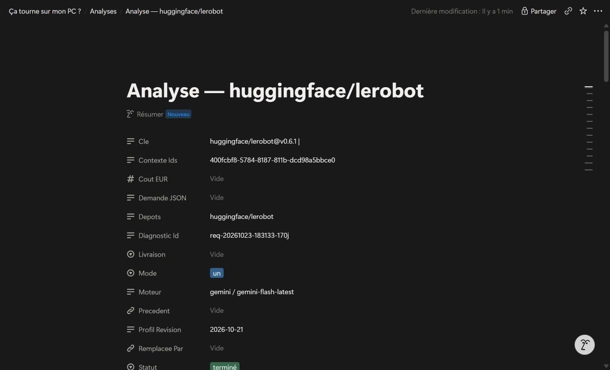
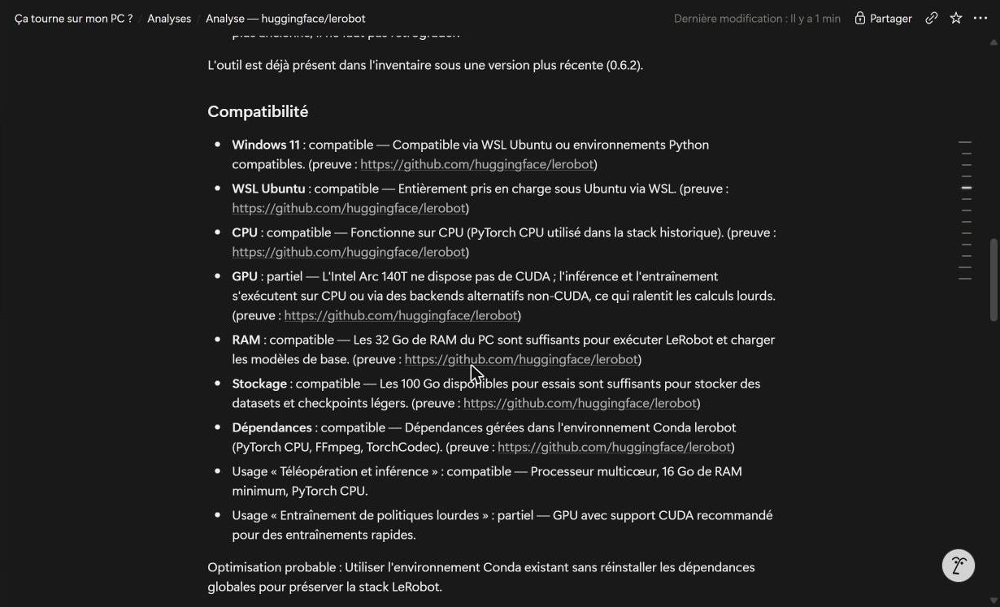
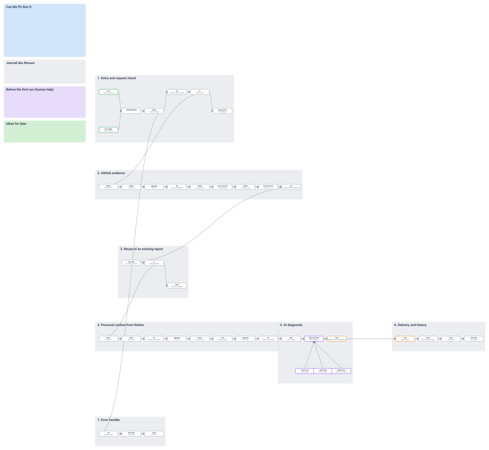
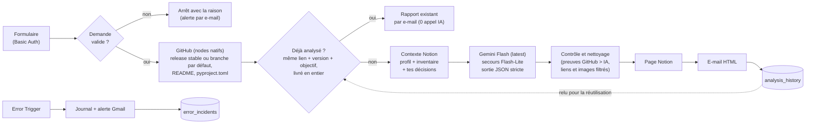

# Ça tourne sur mon PC ? — un seul workflow n8n

> Colle l'URL d'un dépôt GitHub public : le workflow lit sa dernière release stable (ou, à défaut, sa branche par défaut), croise avec **ton** PC et **tes** outils (Notion), demande un diagnostic strict à Gemini, puis t'envoie un rapport en français par e-mail et dans Notion. **Rien n'est installé, rien n'est exécuté** : c'est une analyse de documents.

    

| | |
|---|---|
| Workflow | `Can My PC Run It` : **1 workflow, 40 nodes** en 7 blocs numérotés, 11 sticky notes |
| Formats livrés | [`n8n/workflows/can-my-pc-run-it.workflow.ts`](n8n/workflows/can-my-pc-run-it.workflow.ts) (SDK n8n, pour n8n-cli) et [`exports/can-my-pc-run-it.json`](exports/can-my-pc-run-it.json) (import direct) |
| Schéma du diagnostic | version 4.0 (un rapport par demande) |
| Données | 2 Data Tables n8n, remplies par le workflow lui-même |
| Version | 3.1 — 23 octobre 2026, après une revue hostile ([`revues/`](revues/REVUE_2026-10-23.md)) : correctifs de sécurité et de fiabilité, 54 nodes ramenés à 40 : un seul dépôt par demande, plus de lecture des issues ni de `requirements.txt`. La version à 47 nodes (plusieurs dépôts, comparaison, issues, `requirements.txt`) est dans l'historique git (commit `6760340`), la variante à 157 nodes aussi (commit `b4c46da`) |
| Document de transfert | [`docs/HANDOVER.md`](docs/HANDOVER.md) : fiche d'identité, credentials, alertes, kill switch |

> **État du déploiement** : cette version 3.1 est dans GitHub ; l'instance n8n fait encore tourner la 3.0. Rien n'a été poussé sur l'instance : voir « Tests effectués ».

## Aperçu

| E-mail reçu | Une carte par dépôt |
|---|---|
|  |  |

*Rapport réel du test du 23 octobre 2026 (`huggingface/lerobot`, version v0.6.1, workflow en version 3.0).*

La page créée dans la base « Analyses » de Notion :





Le canvas, dessiné depuis le JSON livré (mêmes positions et mêmes sticky notes que dans n8n ; le fichier SVG se zoome) : [`docs/img/canvas-plan.svg`](docs/img/canvas-plan.svg).



## Schéma



## Les 4 piliers

1. **Entrées** — formulaire protégé par Basic Auth (URL GitHub, objectif facultatif, « refaire l'analyse ») ; Error Trigger.
2. **Sorties** — page Notion (rapport + JSON complet en bas de page), e-mail HTML, e-mail « rapport existant », alerte d'erreur.
3. **Outils** — GitHub, Notion, Gemini, Gmail, Data Tables, tous en nodes natifs.
4. **Architecture** — un seul workflow, 7 blocs visibles (un sticky note gris par bloc) autour d'un seul nœud `CONFIGURATION`.

## Les règles du cours, une par une

Le détail règle par règle (60 règles du cours « n8n x Eugenia ») est dans la [revue](revues/REVUE_2026-10-23.md#conformité-au-cours). Résumé :

| Règle | Comment c'est respecté |
|---|---|
| Sticky notes | 11 : fiche de specs avec responsables (bleu), journal des revues au format du cours (gris), aide humaine avant le premier lancement (violet), idées (vert), un sticky gris par bloc. Code couleur imposé par [`n8n-standards.json`](n8n/config/n8n-standards.json). Plus de note jaune à la livraison |
| Credentials renommés | `Google Gemini - Free Tier`, `Gmail - Mathieu`, `Notion - Eugenia Workspace`, `Basic Auth - Diagnostic Form`, `GitHub - Public Repositories Read` |
| Workflow propre | noms « Outil - Action » en Title Case anglais, variables en camelCase, un seul `CONFIGURATION` (avec `env` et `limitItems`), 7 blocs, notes sur les nodes importants |
| Nodes natifs d'abord | GitHub, Notion, Gmail, Data Table, Loop Over Items, Switch, Limit, XML, Extract from File, chaîne LLM Gemini avec parseur et modèle de secours. **Aucun HTTP Request.** Seuls 2 Code nodes, annotés : rendu du rapport (Markdown + HTML depuis le même JSON) et contrôle du diagnostic |
| Modèles IA « latest » | `gemini-flash-latest` et `gemini-flash-lite-latest`, modifiables dans `CONFIGURATION` |
| Moins de workflows | 1 workflow, 40 nodes (la v2 en comptait 7 et environ 150) |
| Mode test | `CONFIGURATION.env` autre que `production` : le node `Limit - Analyses Pages` ne garde que `limitItems` pages de la base Analyses |
| n8n-cli | `n8ncli validate` et `n8ncli lint --fail-on-warnings` passent sans avertissement |
| Data Tables remplies | 2 tables (voir plus bas) |
| Prompt bien fait | rôle dans le message système, sections XML, 5 exemples, entrées en XML, schéma JSON strict, réponse validée par code : [docs/PROMPTS.md](docs/PROMPTS.md) |

**Écarts connus au cours** (choisis ou restants) : les Code nodes dépassent la cible d'environ 50 lignes (72 et 175 lignes) ; pas de DLQ rejouable (un journal seulement) ; pas de jeu de test à trois catégories sur n8n ; pas de workflow d'Evaluation ; 40 nodes là où le cours déconseille « des dizaines » (en tension avec la consigne « moins de workflows » ) ; le canal d'alerte est Gmail, comme la livraison.

## Les Data Tables

À créer une fois dans n8n (`Data Tables`), avec **ces noms** et ces colonnes, toutes de type texte :

| Table | Colonnes |
|---|---|
| `analysis_history` | `requestId`, `status`, `repositoriesKey`, `versions`, `reuseKey`, `goal`, `summary`, `notionPageId`, `notionUrl`, `model`, `deliveryStatus`, `contextIds`, `note` |
| `error_incidents` | `workflowName`, `nodeName`, `errorMessage`, `executionId`, `executionUrl` |

| Table | Rôle | Écrite par |
|---|---|---|
| `analysis_history` | une ligne par analyse : statut, dépôts et versions, clé de réutilisation, objectif, résumé, lien Notion, modèle, statut de livraison (`complete`, `degraded`, `notion failed`), contexte utilisé | `Data Table - Save Analysis` (upsert) ; lue par `Data Table - Find Existing Analysis` pour la réutilisation |
| `error_incidents` | journal des pannes : workflow, node, message, lien de l'exécution | `Data Table - Log Incident` |

`analysis_history` n'est écrite que quand l'analyse va au bout (pas sur une réutilisation, ni sur un arrêt anticipé) ; `error_incidents` ne reçoit que les erreurs, et seulement si le workflow est son propre Error workflow.

Un rapport est retrouvé par la **clé de réutilisation** = les dépôts avec leur version (`proprietaire/depot@tag`) et l'objectif. Même lien, même version, même objectif : le rapport existant est renvoyé sans appel IA, **à condition qu'il ait été livré en entier** (page Notion créée, aucun fichier illisible). Une nouvelle release change la clé, donc relance l'analyse. Un dépôt sans release stable est examiné sur sa branche par défaut : sa « version » est alors `branche (date du dernier push)`, donc la clé change à chaque push. L'option « Refaire l'analyse » du formulaire ignore le raccourci.

## Tes décisions : installé, ignoré, désinstallé

La base Notion « Analyses » a une propriété **`Decision`** (sélection : `installé`, `ignoré`, `désinstallé`) que **tu remplis à la main** sur la page d'une analyse. Le workflow ne l'écrit jamais ; il la **lit à chaque analyse** et la donne à l'IA :

| Décision sur une analyse | Ce que fait l'IA aux analyses suivantes |
|---|---|
| `installé` | le dépôt est **connu** même s'il n'est pas dans l'inventaire : relation « même outil » avec ta version analysée, et il compte parmi tes outils présents pour chercher doublons, compléments et conflits avec les autres dépôts |
| `ignoré` | elle le rappelle et ne le recommande plus, sauf changement essentiel |
| `désinstallé` | elle le traite comme absent et signale le motif comme une inconnue |

Une décision s'applique à une analyse d'un **seul dépôt** (les anciennes pages de comparaison, avec plusieurs dépôts, sont ignorées) ; s'il y en a plusieurs pour le même dépôt, la page **éditée en dernier** compte (modifier une ancienne page change donc la décision retenue). Pour garder l'état d'un outil à long terme, l'inventaire (`Etat`, `Presence`, `Version`) reste la référence. La réutilisation ne regarde ni les décisions ni le profil : après un changement, mets « Refaire l'analyse » sur Oui.

Un dépôt est relié à un outil de l'inventaire quand les **noms sont identiques** une fois normalisés (`huggingface/lerobot` et l'outil « LeRobot »). Un outil qui porte un autre nom reste visible de l'IA dans l'inventaire complet.

## Mise en service

### 1. Prérequis

- n8n 2.x (Data Tables, nodes Gemini).
- Un espace Notion avec le profil machine, la base « Inventaire » et la base « Analyses » (avec sa propriété `Decision`) : [docs/notion-setup-prompt.md](docs/notion-setup-prompt.md) est le prompt à donner à ChatGPT pour les créer avec les bons noms de propriétés. Les 3 identifiants à copier dans `CONFIGURATION` sont ceux de la page du profil et des sources de données (« data source ») des bases Inventaire et Analyses ; le moyen de les retrouver n'est pas encore documenté ici.
- Les credentials suivants, **avec ces noms** :

| Credential | Type n8n | Remarque |
|---|---|---|
| `Google Gemini - Free Tier` | Google Gemini(PaLM) API | clé gratuite Google AI Studio |
| `Gmail - Mathieu` | Gmail OAuth2 | |
| `Notion - Eugenia Workspace` | Notion OAuth2 | partager le profil et les deux bases avec l'intégration |
| `Basic Auth - Diagnostic Form` | HTTP Basic Auth | protège le formulaire |
| `GitHub - Public Repositories Read` | GitHub API (token) | token *fine-grained*, accès « Public repositories (read-only) », aucune permission |

### 2. Importer

- **Import direct** : n8n → Workflows → Import from file → [`exports/can-my-pc-run-it.json`](exports/can-my-pc-run-it.json), puis choisir les credentials sur les nodes signalés.
- **Avec n8n-cli** : `npm install`, renseigner `n8n/config/n8n-cli.json` (projet et dossier), enregistrer l'instance (`npx n8ncli env edit PROD --url https://<ton-n8n> --access-token <jeton>`), puis `npx n8ncli push`.

### 3. Premier lancement

1. Créer les 2 Data Tables (tableau plus haut). Elles ne sont plus créées par le workflow.
2. Dans `CONFIGURATION`, remplacer les 3 identifiants Notion (`REPLACE_WITH_...`) et l'adresse e-mail. `env` reste sur `production` ; mettre `test` pour limiter la lecture de la base Analyses pendant un essai.
3. Publier, puis `Settings` → `Error workflow` → choisir ce même workflow (n8n n'accepte ce réglage qu'une fois le workflow publié).

Le formulaire est alors à `https://<ton-n8n>/form/can-my-pc-run-it` (identifiant et mot de passe du credential Basic Auth).

### Utilisation

1. Ouvrir le formulaire, coller l'URL d'**un** dépôt GitHub public, ajouter l'objectif si besoin.
2. Quelques minutes plus tard : e-mail et page Notion (avec le JSON complet en bas).
3. Une demande refusée (URL invalide, plusieurs dépôts) arrête l'exécution et t'envoie la raison par e-mail (gestionnaire d'erreurs, workflow publié). Un dépôt sans release stable est analysé sur sa branche par défaut, et le rapport le dit.

## Coût, quotas et données personnelles

- **Appels Gemini par exécution** : 1 en général ; au pire 4 (2 essais, chacun avec le modèle principal puis le modèle de secours). Une réutilisation n'en fait aucun.
- **Taille d'un appel** (estimation à 4 caractères par token) : le prompt et le schéma font environ 27 000 caractères (7 000 tokens), auxquels s'ajoutent les preuves (README jusqu'à 9 000 caractères, `pyproject.toml` jusqu'à 5 000, notes de release 3 000), le profil et l'inventaire ; en sortie, au plus `maxOutputTokens` (32 768) tokens.
- **Prix** : non chiffré ici, il dépend de ton offre Gemini (la clé gratuite est limitée par des quotas, pas facturée). Les alias `-latest` peuvent changer de modèle sans prévenir : relire `CONFIGURATION` à chaque audit. Aucun plafond mensuel n'est appliqué (le garde-fou « budget mensuel » existait dans la variante à 157 nodes).
- **Données envoyées à Gemini** : ton profil machine, l'inventaire (usages, retours, raisons d'abandon, incertitudes), tes décisions et les textes GitHub lus. Elles restent aussi dans les exécutions de n8n (`saveDataSuccessExecution: all`) : réduire ce réglage dans `Settings` si tu ne veux pas les conserver.
- **Contenu hostile** : un README ou des notes de release peuvent tenter de pousser le modèle à écrire une image ou un lien piégé. Le code retire des textes de l'IA tout lien et toute image qui ne pointent pas vers le dépôt examiné ou vers tes décisions ([docs/PROMPTS.md](docs/PROMPTS.md)).

## Vérifier

```bash
npm install            # installe @workflows-accelerator/n8n-cli
npm run check          # build + conversion .workflow.ts + validate + lint + tests
```

Ou séparément :

```bash
npx n8ncli validate --no-version-check
npx n8ncli lint --fail-on-warnings
npm test               # 41 tests : expressions du workflow, 2 Code nodes, 4 e-mails et prompt, sans n8n ni appel réseau
```

Le lint applique les standards du cours ([`n8n/config/n8n-standards.json`](n8n/config/n8n-standards.json)) : noms Title Case, variables camelCase, texte en anglais, notes obligatoires sur les Code nodes, couleurs des sticky notes. Les tests lisent `exports/can-my-pc-run-it.json` et exécutent ses expressions et ses Code nodes avec des données d'essai (`WORKFLOW_JSON=<fichier>` permet de les rejouer sur une autre version).

## Régénérer le workflow

Le workflow est **généré** par un petit script Python (un fichier par bloc du canvas dans [`tools/`](tools/)), pour que les noms, les couleurs et les expressions restent cohérents :

```bash
python tools/build.py                       # exports/can-my-pc-run-it.json (profil portable : aucun credential, identifiants fictifs)
node tools/convert.mjs exports/can-my-pc-run-it.json n8n/workflows/can-my-pc-run-it.workflow.ts
python tools/render_canvas.py               # docs/img/canvas-plan.svg
```

Pour produire une version prête à déployer sur ton instance (credentials et identifiants réels, jamais commités) : copier [`tools/instance.example.json`](tools/instance.example.json) en `tools/instance.local.json`, le remplir, puis `PROFILE=instance python tools/build.py`.

| Dossier | Contenu |
|---|---|
| `tools/s_*.py` | un fichier par bloc : entrées, preuves GitHub, réutilisation et contexte, diagnostic, livraison, erreurs, notes |
| `tools/code/` | les 2 Code nodes (contrôle du diagnostic, rendu du rapport) en JavaScript lisible |
| `tools/prompts/` | le prompt (système + utilisateur XML) |
| `tests/` | tests automatiques (`npm test`) |
| `exports/` | JSON importable |
| `n8n/` | `.workflow.ts` et configuration n8n-cli |
| `docs/` | prompt, mise en place Notion, document de transfert, captures |
| `revues/` | revue hostile du 23 octobre 2026 : coups, preuves, plan de reprise |

## Surveillance et arrêt d'urgence

- Toute exécution en erreur déclenche le bloc 7 : incident dans `error_incidents` et e-mail avec le lien de l'exécution. Le canal est Gmail, comme la livraison : si Gmail tombe, aucune alerte ne part (voir [`docs/HANDOVER.md`](docs/HANDOVER.md)).
- Arrêt d'urgence : dépublier le workflow, puis révoquer les clés si une fuite est suspectée (procédure dans le document de transfert).

## Tests effectués

### Test réel de bout en bout (23 octobre 2026, workflow en version 3.0, 48 nodes à l'époque)

GitHub, Notion, Gmail et Gemini réels, sur `huggingface/lerobot`, instance n8n cloud 2.44.5, workflow non publié. L'essai a démarré **deux fois** à 2 secondes d'intervalle (probablement un appel rejoué par l'outil de test) : 2 pages Notion et 2 e-mails identiques ont été créés ; la ligne `analysis_history` est mise à jour, pas dupliquée.

| Étape | Résultat |
|---|---|
| Preuves GitHub (4 nodes natifs à l'époque) | dernière release stable v0.6.1 parmi 11 releases, licence Apache-2.0, README lu à ce tag (réduit à l'introduction et à « Quick Start »), 40 issues lues dont aucune sur l'installation |
| Réutilisation | aucune analyse existante pour cette clé : l'analyse continue |
| Contexte Notion | 5 sections de profil et 10 outils lus ; LeRobot relié au dépôt |
| Diagnostic IA | le modèle principal a répondu « service indisponible », le modèle de secours a pris le relais ; JSON valide du premier coup, contrôles passés, statut « terminé » ; conclusion : garder LeRobot 0.6.2 et ne pas rétrograder, GPU Intel Arc « partiel » (pas de CUDA) |
| Livraison | 1 page dans « Analyses » (statut « terminé », propriétés remplies), 1 e-mail HTML avec le JSON joint (10,2 ko), 1 ligne `done` dans `analysis_history` |

### Essais complémentaires du 23 octobre (version 3.0)

Pour ceux-ci, les nodes GitHub étaient remplacés par des données de test (sauf pour les fichiers de dépendances) et les envois Gmail et la création Notion par des simulations ; les lectures Notion, les appels Gemini et les écritures dans les Data Tables étaient réels.

| Test | Résultat |
|---|---|
| Fichiers de dépendances (GitHub réel, envois simulés) : `pyproject.toml` de LeRobot lu au tag v0.6.1, `requirements.txt` absent sans erreur | l'IA compare `requires-python >=3.12`, `torch>=2.7,<2.12.0` et `numpy>=2.0.0,<2.3.0` avec ta pile installée (Python 3.12.15, PyTorch 2.11.0+cpu) et cite le fichier comme preuve ; dépendances « compatible » |
| Décisions : propriété `Decision` lue en vrai dans Notion (7 pages, aucune décision), puis décision « ignoré » simulée sur LeRobot | la décision arrive dans les entrées de l'IA ; le rapport la cite (`decision-1`) et dit que le dépôt a été ignoré ; contrôles passés |
| Même demande relancée | rapport retrouvé par sa clé, e-mail « rapport existant », aucun appel IA ni lecture Notion |
| Comparaison de 2 dépôts (fonction retirée en version 3.1) | 2 passages de boucle, 2 rapports et une comparaison |
| « Refaire l'analyse » = Oui | analyse refaite, la ligne existante est **mise à jour** (pas de doublon) |
| Demande invalide (URL GitLab) | arrêt avec « Invalid request: Not an https GitHub repository URL… » |
| Publication : workflow publié, « Error workflow » réglé sur lui-même, anciens workflows dépubliés | seul workflow actif ; formulaire de production : 401 sans identifiants (protégé), ancien formulaire : 404 |
| Gestionnaire d'erreurs | incident journalisé dans `error_incidents`, alerte construite (non envoyée) |

### Version 3.1 (ce dépôt)

| Contrôle | Résultat |
|---|---|
| `n8ncli validate` / `n8ncli lint --fail-on-warnings` | `[VALID]` / `[LINT-PASS]`, 0 avertissement |
| Validateur du skill n8n-pro-max | 0 erreur, 0 avertissement |
| `npm test` | 41 tests passent : vérification de l'URL (un seul dépôt), correspondance outil/dépôt, version examinée (release ou branche), nettoyage avant le node XML, lecture de `pyproject.toml`, filtrage des liens et images de l'IA, validations qui restent strictes, clé de réutilisation identique à l'écriture et à la lecture, filtre de réutilisation, Limit, taille du workflow, **les 4 e-mails** (rapport, rapport d'un diagnostic en échec, rapport existant, alerte d'erreur : destinataire, sujet, lien Notion, repli sans page Notion, échappement du texte de l'IA et des erreurs, date, lien de l'exécution) et **le prompt** (exemples et règles écrits avec les balises réellement envoyées à l'IA, limites données une seule fois). Sur l'ancienne version, 7 des tests d'e-mails et 3 de ceux du prompt échouent, ce qui prouve qu'ils contrôlent quelque chose |

**Pas encore testé**, faute de l'avoir importée dans n8n : la version 3.1 entière sur l'instance (aucun appel GitHub, Notion, Gmail ou Gemini réel avec elle), la lecture d'un dépôt sans release sur GitHub réel, le plantage du node XML corrigé (prouvé sur la bibliothèque `xml2js`, pas sur le node n8n), l'Error Trigger en production, une vraie soumission du formulaire publié, une réponse IA invalide et une panne Notion. Les e-mails sont testés en local (rendu à partir de données d'essai, aucun envoi) : l'envoi réel par Gmail n'a pas été refait avec la 3.1, et le prompt n'a pas été rejoué avec un vrai appel Gemini sur le schéma 4.0.

## Limites connues

- Sont lus : `README.md` (pas `README.rst` ni un autre nom : le rapport le signale), `pyproject.toml` (s'il existe, sinon rien) et les notes de release. Ni les issues ni `requirements.txt` ne sont lues. Ce que ces fichiers ne disent pas reste « inconnu » dans le rapport. Les dépôts qui déclarent leurs dépendances ailleurs (`requirements.txt`, `package.json`, `environment.yml`…) ne sont pas couverts. Un README sans titres `#` ou `##` est coupé à environ 3 000 caractères.
- Pas de recherche Web : les alternatives externes sont dans les inconnues.
- Les décisions ne s'appliquent qu'aux analyses d'un seul dépôt ; une ancienne page de comparaison est ignorée.
- Sans release stable (brouillons et pré-releases ignorés), la branche par défaut est examinée : le résultat peut changer au prochain push.
- Un seul dépôt par demande : pour en comparer deux, lancer deux demandes et lire les deux rapports.
- Gemini Flash peut mettre plus de 3 minutes sur un diagnostic long (le modèle de secours ne reprend la main qu'en cas d'erreur, pas de lenteur). Le workflow ne fixe aucun délai maximal : certaines offres n8n plafonnent la durée d'une exécution (180 s sur l'essai gratuit) et coupent alors un appel lent.
- Le profil est lu en Markdown (Notion peut tronquer une page très longue) ; l'inventaire est donné en entier à l'IA, il doit rester court (une cinquantaine d'outils).
- La réutilisation ignore les changements du profil Notion et des décisions : utiliser « Refaire l'analyse ».
- Une analyse dont l'e-mail n'a pas pu partir n'est pas enregistrée : la relancer refait un appel IA et crée une deuxième page Notion.
- `Error workflow` : n8n n'autorise ce réglage qu'après la première publication.
- Les fonctions de la variante à 157 nodes (RAG, attente d'un tag, budget mensuel, file de rejeu, surveillance quotidienne de l'inventaire) ne sont plus dans le dépôt ; elles sont dans l'historique git (commit `b4c46da`).

## Journal des revues

| Date | Version | Changement |
|---|---|---|
| 2026-10-23 | 3.1 | Revue hostile et correctifs : liens et images de l'IA filtrés, texte nettoyé avant le node XML, réutilisation limitée aux rapports livrés en entier, branche par défaut examinée sans release stable, correspondance outil/dépôt exacte, `env` et `limitItems` avec un Limit ; simplification (54 à 40 nodes) : JSON joint, modèle de réparation, création des tables, boucle sur plusieurs dépôts avec comparaison, issues et `requirements.txt` retirés ; document de transfert, tests, plan SVG du canvas |
| 2026-10-23 | 3.1 | Prompt : exemples écrits avec les balises réellement envoyées à l'IA, limites données une seule fois ; 19 tests de plus (4 e-mails, prompt) |
| 2026-10-23 | 3.0 | Sept workflows fusionnés en un seul : nodes natifs d'abord, sticky notes, credentials renommés, alias Gemini *latest*, réutilisation par lien, décisions installé / ignoré / désinstallé lues par l'IA, Data Tables remplies par le workflow, `.workflow.ts` et lint n8n-cli |
| 2026-10-21 | 2.0 | Première version en production, sept workflows |

Briques reprises des templates de Lucas Peyrin : **5160** (modèle de secours), **5144** (JSON vers XML, remplacé ici par le node XML natif), **20499** (gestion d'erreurs, allégée).
