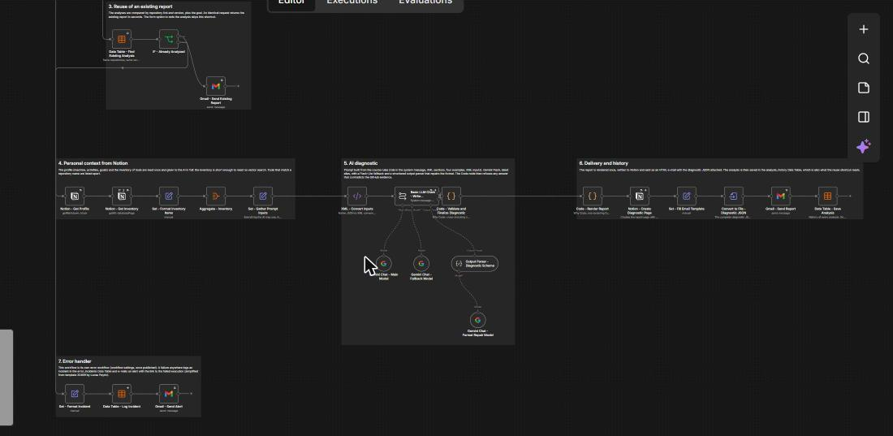
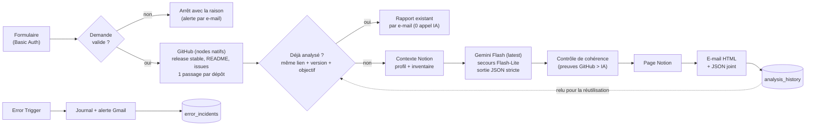

# Ça tourne sur mon PC ? — un seul workflow n8n

> Colle l'URL d'un dépôt GitHub public : le workflow lit sa dernière release stable, croise avec **ton** PC et **tes** outils (Notion), demande un diagnostic strict à Gemini, puis t'envoie un rapport en français par e-mail et dans Notion. **Rien n'est installé, rien n'est exécuté** : c'est une analyse de documents.

   

| | |
|---|---|
| Workflow | `Can My PC Run It` : **1 workflow, 48 nodes** en 7 blocs numérotés, 13 sticky notes |
| Formats livrés | [`n8n/workflows/can-my-pc-run-it.workflow.ts`](n8n/workflows/can-my-pc-run-it.workflow.ts) (SDK n8n, pour n8n-cli) et [`exports/can-my-pc-run-it.json`](exports/can-my-pc-run-it.json) (import direct) |
| Schéma du diagnostic | version 3.0 (JSON joint à chaque e-mail) |
| Données | 2 Data Tables n8n, remplies par le workflow lui-même |
| Version | 3.0 — 23 octobre 2026 : les 7 workflows de la v2 (environ 150 nodes) deviennent un workflow de 48 nodes. La variante complète à 157 nodes est conservée dans [`archive/`](archive/v3-full-157-nodes/) |

## Aperçu

| E-mail reçu | Une carte par dépôt |
|---|---|
|  |  |

*Exemple de rapport de la v2 : le rendu est le même, sans la puce du commit (plus utilisée). Il sera remplacé par un rapport de cette version après le test réel.*

Le workflow dans n8n, vu d'ensemble :


Entrées, preuves GitHub et réutilisation :


Contexte Notion, diagnostic IA, livraison :



## Schéma



## Les 4 piliers

1. **Entrées** — formulaire protégé par Basic Auth (URL GitHub, objectif facultatif, « refaire l'analyse ») ; Error Trigger.
2. **Sorties** — page Notion (rapport + JSON), e-mail HTML avec le JSON en pièce jointe, e-mail « rapport existant », alerte d'erreur.
3. **Outils** — GitHub, Notion, Gemini, Gmail, Data Tables, tous en nodes natifs.
4. **Architecture** — un seul workflow, 7 blocs visibles (un sticky note gris par bloc) autour d'un seul nœud `CONFIGURATION`.

## Les règles du prof, une par une

| Règle | Comment c'est respecté |
|---|---|
| Sticky notes | 13 : fiche de specs (bleu), à faire (jaune), aide humaine (violet), idées (vert), journal des revues (gris), un sticky gris par bloc. Code couleur du cours imposé par [`n8n-standards.json`](n8n/config/n8n-standards.json) |
| Credentials renommés | `Google Gemini - Free Tier`, `Gmail - Mathieu`, `Notion - Eugenia Workspace`, `Basic Auth - Diagnostic Form`, `GitHub - Public Repositories Read` |
| Workflow propre | noms « Outil - Action » en Title Case anglais, variables en camelCase, un seul `CONFIGURATION`, 7 blocs, notes sur les nodes importants, délai maximal d'exécution |
| Nodes natifs d'abord | GitHub, Notion, Gmail, Data Table, Loop Over Items, Switch, XML, Convert to File, Extract from File, chaîne LLM Gemini avec parseur et modèle de secours. **Aucun HTTP Request.** Seuls 2 Code nodes, justifiés dans leur note : rendu du rapport (Markdown + HTML depuis le même JSON) et contrôle du diagnostic |
| Modèles IA « latest » | `gemini-flash-latest` et `gemini-flash-lite-latest`, modifiables dans `CONFIGURATION` |
| Moins de workflows | 1 workflow, 48 nodes (la v2 en comptait 7 et environ 150) |
| n8n-cli | `n8ncli validate` et `n8ncli lint --fail-on-warnings` passent sans avertissement |
| Data Tables remplies | 2 tables, alimentées à chaque exécution (voir plus bas) |
| Prompt bien fait | rôle dans le message système, sections XML, 4 exemples, entrées en XML, schéma JSON strict, réponse validée par code : [docs/PROMPTS.md](docs/PROMPTS.md) |

## Les Data Tables

| Table | Rôle | Écrite par |
|---|---|---|
| `analysis_history` | une ligne par analyse : statut, dépôts et versions, clé de réutilisation, objectif, résumé, lien Notion, modèle, statut de livraison, contexte utilisé | `Data Table - Save Analysis` (upsert) ; lue par `Data Table - Find Existing Analysis` pour la réutilisation |
| `error_incidents` | journal des pannes : workflow, node, message, lien de l'exécution | `Data Table - Log Incident` |

Un rapport est retrouvé par la **clé de réutilisation** = les dépôts avec leur version (`proprietaire/depot@tag`) et l'objectif. Même lien, même version, même objectif : le rapport existant est renvoyé sans appel IA. Une nouvelle release change la clé, donc relance l'analyse. L'option « Refaire l'analyse » du formulaire ignore le raccourci.

## Mise en service

### 1. Prérequis

- n8n 2.x (Data Tables, nodes Gemini).
- Un espace Notion avec le profil machine, la base « Inventaire » et la base « Analyses » : [docs/notion-setup-prompt.md](docs/notion-setup-prompt.md) est le prompt à donner à ChatGPT pour les créer avec les bons noms de propriétés.
- Les credentials suivants, **avec ces noms** :

| Credential | Type n8n | Remarque |
|---|---|---|
| `Google Gemini - Free Tier` | Google Gemini(PaLM) API | clé gratuite Google AI Studio |
| `Gmail - Mathieu` | Gmail OAuth2 | |
| `Notion - Eugenia Workspace` | Notion OAuth2 | partager le profil et les deux bases avec l'intégration |
| `Basic Auth - Diagnostic Form` | HTTP Basic Auth | protège le formulaire |
| `GitHub - Public Repositories Read` | GitHub API (token) | token *fine-grained*, accès « Public repositories (read-only) », aucune permission |

### 2. Importer

- **Import direct** : n8n → Workflows → Import from file → [`exports/can-my-pc-run-it.json`](exports/can-my-pc-run-it.json), puis choisir les credentials sur les nodes signalés.
- **Avec n8n-cli** : `npm install`, renseigner `n8n/config/n8n-cli.json` (projet et dossier), enregistrer l'instance (`npx n8ncli env edit PROD --url https://<ton-n8n> --access-token <jeton>`), puis `npx n8ncli push`.

### 3. Premier lancement

1. Exécuter une fois `Manual - Setup Data Tables` : crée les 2 Data Tables.
2. Dans `CONFIGURATION`, remplacer les 3 identifiants Notion (`REPLACE_WITH_...`) et l'adresse e-mail.
3. Publier, puis `Settings` → `Error workflow` → choisir ce même workflow (n8n n'accepte ce réglage qu'une fois le workflow publié).

Le formulaire est alors à `https://<ton-n8n>/form/can-my-pc-run-it` (identifiant et mot de passe du credential Basic Auth).

### Utilisation

1. Ouvrir le formulaire, coller une URL GitHub par ligne (3 au plus : plusieurs dépôts = comparaison), ajouter l'objectif si besoin.
2. Quelques minutes plus tard : e-mail (JSON joint) et page Notion.
3. Une demande refusée (URL invalide, trop de dépôts) ou un dépôt sans release stable arrête l'exécution et t'envoie la raison par e-mail (gestionnaire d'erreurs, workflow publié).

## Vérifier avec n8n-cli

```bash
npm install            # installe @workflows-accelerator/n8n-cli
npm run check          # build + conversion .workflow.ts + validate + lint
```

Ou séparément :

```bash
npx n8ncli validate --no-version-check
npx n8ncli lint --fail-on-warnings
```

Le lint applique les standards du cours ([`n8n/config/n8n-standards.json`](n8n/config/n8n-standards.json)) : noms Title Case, variables camelCase, texte en anglais, notes obligatoires sur les Code nodes, couleurs des sticky notes.

## Régénérer le workflow

Le workflow est **généré** par un petit script Python (un fichier par bloc du canvas dans [`tools/`](tools/)), pour que les noms, les couleurs et les expressions restent cohérents :

```bash
python tools/build.py                       # exports/can-my-pc-run-it.json (profil portable : aucun credential, identifiants fictifs)
node tools/convert.mjs exports/can-my-pc-run-it.json n8n/workflows/can-my-pc-run-it.workflow.ts
```

Pour produire une version prête à déployer sur ton instance (credentials et identifiants réels, jamais commités) : copier [`tools/instance.example.json`](tools/instance.example.json) en `tools/instance.local.json`, le remplir, puis `PROFILE=instance python tools/build.py`.

| Dossier | Contenu |
|---|---|
| `tools/s_*.py` | un fichier par bloc : entrées, preuves GitHub, réutilisation et contexte, diagnostic, livraison, erreurs, notes |
| `tools/code/` | les 2 Code nodes (contrôle du diagnostic, rendu du rapport) en JavaScript lisible |
| `tools/prompts/` | le prompt (système + utilisateur XML) |
| `exports/` | JSON importable |
| `n8n/` | `.workflow.ts` et configuration n8n-cli |
| `archive/` | la variante complète à 157 nodes (RAG, attente d'un tag, budget, file de rejeu, surveillance quotidienne) |

## Surveillance et arrêt d'urgence

- Toute exécution de production en erreur déclenche le bloc 7 : incident dans `error_incidents` et e-mail avec le lien de l'exécution.
- Arrêt d'urgence : dépublier le workflow.

## Tests effectués (23 octobre 2026, instance n8n cloud 2.44.5, workflow non publié)

Le credential GitHub n'existait pas encore : les 4 nodes GitHub ont été **remplacés par des données de test** dans ces essais, les envois Gmail et la création de la page Notion étaient **simulés**. Restent réels : les lectures Notion (profil et inventaire), les appels Gemini et les écritures dans les Data Tables.

| Test | Résultat |
|---|---|
| `n8ncli validate` | `[VALID]` |
| `n8ncli lint --fail-on-warnings` | `[LINT-PASS]`, 0 avertissement |
| Validateur du skill n8n-pro-max | 0 erreur, 0 avertissement |
| Parcours complet, 1 dépôt | diagnostic « terminé » du premier coup (JSON valide, contrôles passés, contexte Notion réel : 5 sections de profil, 10 outils) ; le modèle principal a répondu « service indisponible », le modèle de secours a pris le relais ; ligne ajoutée dans `analysis_history` |
| Même demande relancée | rapport retrouvé par sa clé, e-mail « rapport existant », aucun appel IA ni lecture Notion |
| Comparaison de 2 dépôts | 2 passages de boucle, 2 rapports et une comparaison |
| « Refaire l'analyse » = Oui | analyse refaite, la ligne existante est **mise à jour** (pas de doublon) |
| Demande invalide (URL GitLab) | arrêt avec « Invalid request: Not an https GitHub repository URL… » |
| Gestionnaire d'erreurs | incident journalisé dans `error_incidents`, alerte construite |
| `Manual - Setup Data Tables` | les 2 tables sont créées (ou reconnues si elles existent) |

**Pas encore testé** : les nodes GitHub natifs avec un vrai credential, une vraie page Notion et un vrai e-mail avec cette version, le cas « aucune release stable » (arrêt avec la raison), l'Error Trigger en production.

## Limites connues

- Seul le README est lu, avec les notes de release et les issues sur l'installation : ce que le README ne dit pas reste « inconnu » dans le rapport.
- Pas de recherche Web : les alternatives externes sont dans les inconnues.
- Un dépôt sans release stable (brouillons et pré-releases ignorés) arrête l'exécution avec la raison.
- Le profil est lu en Markdown (Notion peut tronquer une page très longue) ; l'inventaire est donné en entier à l'IA, il doit rester court (une cinquantaine d'outils).
- La réutilisation ignore les changements du profil Notion : utiliser « Refaire l'analyse ».
- `Error workflow` : n8n n'autorise ce réglage qu'après la première publication.
- La variante complète ([`archive/`](archive/v3-full-157-nodes/)) garde les fonctions retirées ici : RAG, attente d'un tag, budget mensuel, file de rejeu, surveillance quotidienne de l'inventaire.

## Journal des revues

| Date | Version | Changement |
|---|---|---|
| 2026-10-23 | 3.0 | Sept workflows fusionnés en un seul de 48 nodes : nodes natifs d'abord, sticky notes, credentials renommés, alias Gemini *latest*, réutilisation par lien, Data Tables remplies par le workflow, `.workflow.ts` et lint n8n-cli |
| 2026-10-21 | 2.0 | Première version en production, sept workflows |

Briques reprises des templates de Lucas Peyrin : **5160** (modèle de secours), **5144** (JSON vers XML, remplacé ici par le node XML natif), **20499** (gestion d'erreurs, allégée).
